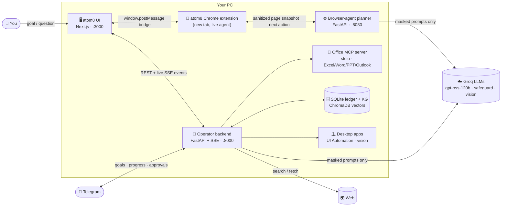
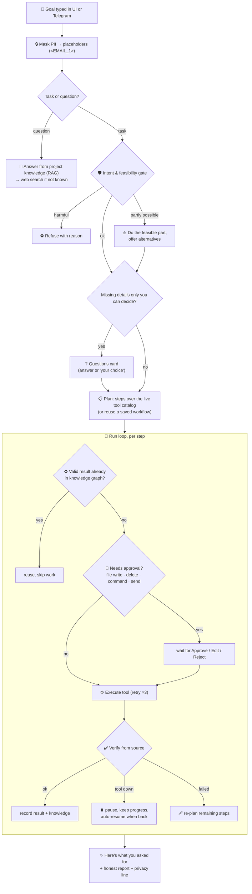
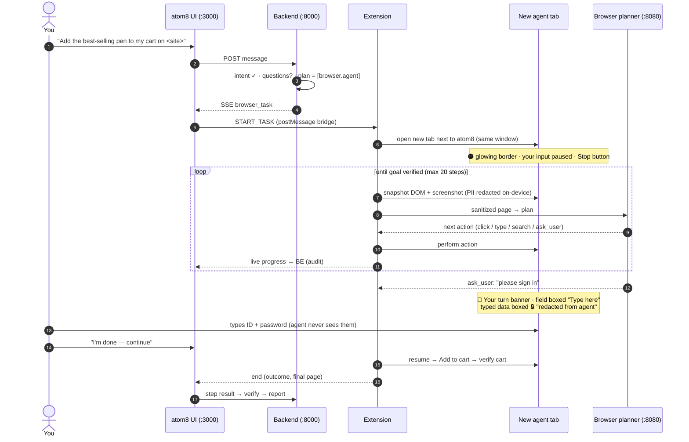
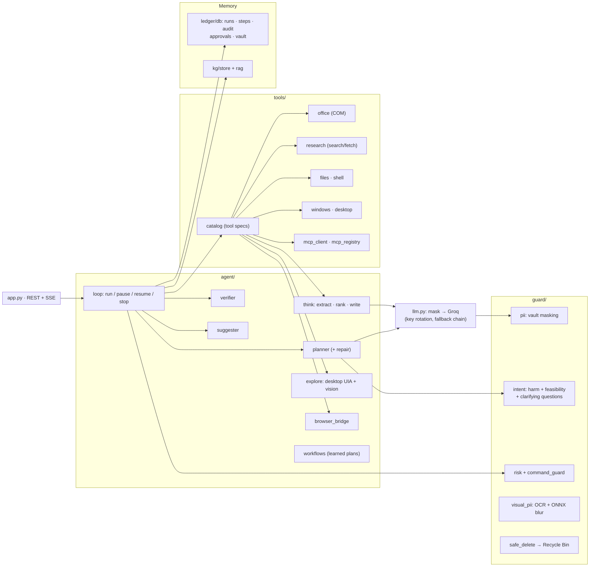

<div align="center">

# ⚛️ atom8

### Your autonomous AI operator: say what you want done, watch it get done, safely.

*HackAttack AMCEC · AI/ML Track 1 · Build Your Own Autonomous AI Operator*

`Groq gpt-oss-120b` · `MCP` · `FastAPI + SSE` · `Next.js` · `Chrome extension` · `SQLite + ChromaDB` · `Telegram`

</div>

---

## 🧭 Why atom8

One real task, like *"find three internships, compare them, save the best to Excel and draft an email for each"*,
means jumping between a browser, a spreadsheet, a document and email, doing every step by hand. Chat assistants
only *tell* you what to do. **atom8 does it**: it plans the steps, runs them across your apps, recovers when
something breaks, checks its own work, and stops to ask you before anything risky or personal.

| You get | Because atom8 |
|---|---|
| **Work actually done** | plans multi-step goals and runs them across the web, Excel, Word, PowerPoint, email drafts, files, the shell and desktop apps |
| **Only safe, possible work** | checks every goal's **intent** (harmful? refuse) and **feasibility** (what can't it do? offer the doable part) before acting |
| **No guessing on vague tasks** | asks short **clarifying questions** first ("which date? which airline?"), or you say *"your choice"* |
| **Your login, your hands** | on websites it works **live in a new tab you watch**; at a login/OTP/CAPTCHA it pauses and you type, never the agent |
| **Results you can trust** | re-reads every result from the source (rows, files, cart) before calling a step done; reports honestly |
| **Resilience** | retries, pauses on outages and resumes from the exact step, re-plans failed steps, never duplicates work |
| **Privacy by design** | personal data is masked before any LLM call, screenshots are blurred, 0 raw PII ever leaves the PC |
| **Control** | approvals for writes/deletes/commands, live pause/stop, full append-only audit, Telegram on your phone |

---

## 🏗️ Architecture

### 1. System overview

atom8 is three cooperating processes plus a browser extension, all on your PC. Only masked text (and blurred
screenshots) ever reaches the cloud LLM.



| Component | Path | Role |
|---|---|---|
| **UI** | `frontend/` | Claude-style chat: projects & threads, live plan cards, approvals, knowledge graph, audit, reports, light/dark |
| **Operator backend** | `backend/` | the brain: intent gate, planner, run loop, tools, verifier, ledger, knowledge graph, Telegram |
| **Browser-agent planner** | `server/` | decides the next click/type on a web page from a sanitized DOM snapshot; detects login/OTP/CAPTCHA walls |
| **Chrome extension** | `browser-extension/` | opens the agent's tab, observes + redacts the page on-device, executes actions, shows the border / "your turn" UI |
| **Office MCP server** | `mcp_servers/office_com/` | Excel / Word / PowerPoint / Outlook-draft tools over MCP (stdio), with an outage switch for demos |
| **Team contract modules** | `modules/` | the team's CONTRACTS.md layout (knowledge graph, explore loop, router, ...) |

### 2. What happens to one goal



### 3. Website tasks: live in a new tab, you log in yourself



### 4. Inside the backend



### 5. Safety & privacy layers

| Layer | Where | What it guarantees |
|---|---|---|
| **Intent gate** | `guard/intent.py` | harmful goals refused (gpt-oss-safeguard + prompt-injection model + capability rules) |
| **Feasibility** | `guard/intent.py` | impossible parts (payments, calls, physical actions) named, with what it *can* do instead |
| **Clarification** | `guard/intent.py` | real-world actions never run on guessed dates/sizes/airlines |
| **Approvals** | `agent/loop.py` | every file write on your PC, delete, non-read shell command, send, MCP install asks first |
| **PII masking** | `guard/pii.py`, `llm.py` | emails/phones/IDs/cards/secrets replaced by placeholders before any LLM call, log, or graph |
| **Screenshot redaction** | `guard/visual_pii.py`, extension | OCR + on-device ONNX blur before any vision call; red boxes on the page |
| **Your credentials** | extension + `server/` | the agent never types passwords/OTPs: it hands the page to you |
| **No hard deletes** | `guard/safe_delete.py` | deletes go to the Recycle Bin |
| **Audit** | `ledger/db.py` | append-only record of every plan, tool call, approval and LLM call (masked) |

---

## 🚀 Run it

**Needs:** Windows, Python 3.11+, Node 20+, Chrome, Microsoft Office (optional, has fallbacks), Groq API key(s).

```bash
copy .env.example .env                                   # add GROQ_API_KEY1..3 (+ optional TELEGRAM_BOT_TOKEN, TELEGRAM_ALLOWED)
python -m venv .venv && .venv\Scripts\activate
pip install -r requirements-local.txt
python -m uvicorn backend.app:app --port 8000            # 🧠 backend
python -m uvicorn server.app.main:app --port 8080        # 🌐 browser-agent planner
cd frontend && npm install && npm run build && npm start # 🖥️ UI → http://localhost:3000
```

**One-time browser setup:** `chrome://extensions` → Developer mode → **Load unpacked** → `browser-extension/`.
Open atom8 (localhost:3000) in that Chrome.

**Telegram (optional):** create a bot with @BotFather, put `TELEGRAM_BOT_TOKEN` and your chat id in
`TELEGRAM_ALLOWED`, restart the backend, then send goals from your phone.

## 🎬 Try these

| Goal | Shows |
|---|---|
| *Find three internships for a 3rd-year CS student, compare eligibility, save the best to a spreadsheet and draft emails* | multi-step planning, Excel via MCP, verified drafts |
| Same goal with **Simulate Excel outage** on | pause on failure, auto-resume, no duplicate rows |
| *On http://127.0.0.1:8765/index.html add the best-selling pen to the cart* (serve `tests/e2e/fixtures/shop`) | new tab, live clicks, login handoff, redaction boxes |
| *Book a flight from Goa to Delhi* | clarifying questions, feasible-part only (never pays) |
| *Open PowerPoint and make 2 slides: hi, hello* | visible Office editing, verified |
| *Write a keylogger for my roommate* | refused by the intent gate |

## 🧪 Tests

```bash
python -m pytest tests/test_selfchecks.py -q          # every module self-check
python tests/e2e/run_scenarios.py all                # Scenario A, Scenario B, general tasks, safety
python tests/e2e/browser_agent_check.py              # new tab + login handoff + cart (real Chromium + extension)
python -m pytest server/tests/test_operator_handoff.py
```

## 🗂️ Repository layout

```
frontend/                Next.js UI (atom8)
backend/                 Operator backend: app · llm · guard/ · agent/ · tools/ · ledger/ · kg/ · channels/telegram
server/                  browser-agent planner (page → next action, login/OTP/CAPTCHA detection)
browser-extension/       Chrome extension: on-device perception + redaction, actions, agent tab UI, atom8 bridge
mcp_servers/office_com/  Office MCP server
modules/                 team CONTRACTS.md modules (kg, explore, router, telegram, ...)
privacy/ ml/ models/     on-device PII detection / redaction models
docs/                    CONTRACTS, PLAN, GUIDELINES, briefs
tests/                   self-checks and end-to-end scenarios
```

<details>
<summary><b>Notes for the team: where this build differs from CONTRACTS.md</b></summary>

- **LLM:** Groq only (no local models). `gpt-oss-120b` plans/reasons, `gpt-oss-safeguard-20b` replaces Granite
  Guardian, `llama-prompt-guard-2-86m` flags prompt injection, `qwen3.8-27b` is the vision model; Cerebras /
  OpenRouter are used only if every Groq key fails. Embeddings are local feature hashing.
- **Extra SSE events:** `assessment`, `clarification`, `browser_task`, `browser_control`, `report`, `hello`.
- **Extra statuses:** run `refused` / `needs_input` / `stopped`; routes `think`, `mcp`, `browser`.
- **New:** `guard/intent.py` (intent, feasibility, clarifying questions), `agent/browser_bridge.py` (browser.agent step).
- **Learned workflows** are saved to `data/workflows/`; `workflows/` keeps the hand-written §6 YAML.
- Without any API key it still works: template planning, heuristic extraction, and every write needs approval.

</details>
